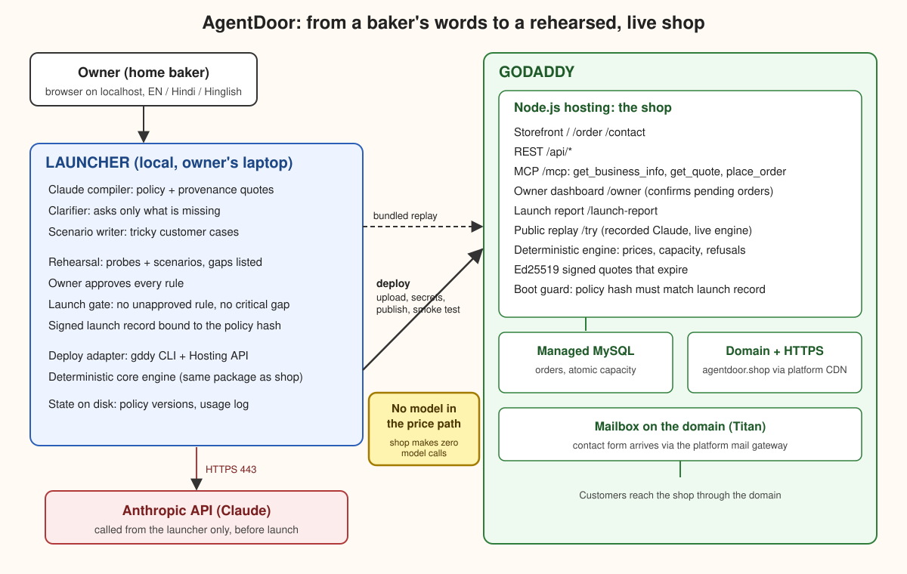

# AgentDoor

**Rehearse your business against tough customers before your first order.** Other tools build you a website. AgentDoor turns a home baker's description into owner-approved rules, rehearses them against realistic customers and a simulated festival rush, enforces them in code (no model in the price path, signed quotes, no oversell), then opens a shop that people and AI assistants can order from.

- **Your busiest day:** 50 rush orders against your own rules: accepted, refused by reason, revenue and "Oversold: 0", using the same booking rule as the live shop.
- **Money at stake:** every rehearsal issue shows the rupees involved, from engine quotes of concrete orders; fixed issues count as protected.
- **Rehearsed badge and /how-we-work:** the live shop shows its rehearsal and links to its rules in plain words with the signed policy fingerprint (also in `/.well-known/agentdoor.json`).

- Live: https://agentdoor.shop (also www)
- Judge entry point: https://agentdoor.shop/launch, the live AgentDoor workspace. Anyone can use it, no access code. Describe your own bakery (English, Hindi or Hinglish), answer Claude's questions, edit products and rules, run the rehearsal, fix issues in place, rerun the free checks and open a preview of your storefront.
- Approved storefront: https://agentdoor.shop (Meera's Kitchen, illustrative persona); ordering at https://agentdoor.shop/order; MCP endpoint https://agentdoor.shop/mcp
- Pages: `/launch` (workspace), `/launch/w/...` (your private draft), `/launch/p/...` (read-only preview link), `/` storefront, `/order`, `/contact`, `/mcp`
- Technical documentation of the first recorded launch (evidence only, not part of the product flow): `/launch-report` and `/try`
- Contact: hello@agentdoor.shop
- Demo video: link added at submission

The bundled shop, "Meera's Kitchen" in Pune, is an illustrative persona based on common home-bakery practices. It is not a real customer.

## Why

A home baker often takes orders over WhatsApp, quotes from memory, under-charges rush jobs and accepts more than she can bake. As customers start sending AI assistants to order for them, a shop without written, enforced rules is exposed. AgentDoor gives a first-time seller those rules in her own words (English, Hindi or Hinglish), proves they hold up before launch, and enforces them in code.

## How it works



1. Describe. Claude (claude-sonnet-5-5, structured output) compiles the description into a declarative policy. Every rule carries provenance: rules the owner stated carry her own quoted words, and defaults or inferences are labelled "AgentDoor suggested this: the owner did not say it". Claude asks only what is missing.
2. Rehearse and approve. The owner approves every rule. A rehearsal runs deterministic probes and Claude-written tricky customer scenarios against the policy and lists gaps. She fixes them and re-runs.
3. Launch. The launch gate blocks until every rule is approved and no critical gap is open, then signs a launch record bound to the policy hash. The shop deploys to GoDaddy Node.js hosting with a storefront and an MCP endpoint (`get_business_info`, `get_quote`, `place_order`).

At runtime there is no model in the price path. Pricing, capacity and refusals are pure functions in `packages/core`. Quotes are Ed25519-signed and expire. Orders go to a durable pending state that the owner confirms. Capacity is reserved atomically in managed MySQL.

## Quick start

A fresh clone can run the tests, the launcher in fixture mode and the workspace. It cannot reproduce the live Meera's Kitchen shop or `/try` without running the launch script and the deploy (see Live mode and deploy), because `bundle/` and `.agentdoor/` are gitignored generated folders.

Requires Node.js 22 and Docker.

```
npm ci
docker compose up -d mysql
npm test            # unit, property and integration tests, replay mode (no key needed)
npm run e2e         # Playwright end-to-end and accessibility tests
npm run launcher    # launcher at http://127.0.0.1:4321, fixture (replay) mode without a key
```

`npm run shop` starts the shop locally and needs the database. `npm run typecheck` runs the TypeScript build check. `scripts/fresh-clone-check.sh` tests the committed files from a fresh clone. `scripts/check-secrets.sh` scans for secrets before a commit.

## The live workspace

The workspace at `/launch` is part of `apps/shop`, in `apps/shop/src/workspace`. Claude is called only there (and in the local launcher); a test enforces that only that module may reference the Claude client. The storefront, ordering, quotes, MCP and owner pages make zero model calls.

### Environment variables

| Variable | What it does |
|---|---|
| `ANTHROPIC_API_KEY` | Key for live Claude calls (compile, clarify, scenarios). Without it no draft can call Claude. |
| `WORKSPACE_OPEN` | Set to `1` to open the workspace to anyone, no code. |
| `WORKSPACE_ACCESS_CODE` | Used when the workspace is not open: gates draft creation behind an early-access dialog. |
| `WORKSPACE_BUDGET_USD` | Global runtime spend cap in dollars (default 10). |

With neither `WORKSPACE_OPEN=1` nor `WORKSPACE_ACCESS_CODE`, the workspace is closed.

### Run it locally

Put `ANTHROPIC_API_KEY` in `.env.local` at the repository root (gitignored; never commit it) and start the database with `docker compose up -d mysql`. For a small live check of the whole model path (two drafts, each through compile, one clarify round and one rehearsal) run `npx tsx scripts/workspace-smoke.ts`; it reads the key from `.env.local` and never prints it. To serve `/launch` from a local shop (`npm run shop`), provide `WORKSPACE_OPEN=1` and the key in the process environment, in addition to the shop's own database and signing settings. Tests never call Claude; recorded fixtures are used only by automated tests.

### The four rehearsal categories

The rehearsal reports four separate categories and never sums them:

- Business-policy gaps: missing operational decisions (for example no daily capacity).
- Pending approvals: rules awaiting the owner's confirmation.
- Scenario mismatches: the engine's answer differs from what the owner would want.
- Engine failures: real correctness failures.

For the recorded Meera launch the first run, recomputed on `/launch-report`, is 2 business-policy gaps, 28 pending approvals, 1 scenario mismatch and 0 engine failures; the final run has 0 open. Two live journeys on production with unseen descriptions gave 2 / 15 / 2 / 0 (English, Kolkata custom cakes, pickup only) and 0 / 18 / 3 / 0 (Hinglish, Delhi gift boxes, three delivery areas).

### Spend and abuse controls

Server-side and MySQL-backed: global cap $10 (`WORKSPACE_BUDGET_USD`), $0.60 per business, at most 3 setup rounds and 2 scenario generations per business, at most 2 concurrent Claude jobs, 6 new businesses per network per hour, per-business request limits, descriptions up to 2000 characters. When a cap is hit the workspace says so and the free deterministic checks keep working. Drafts are private to the browser that made them; previews are read-only links.

Measured on production (19 Nov 2026): compile 18.5 to 19.1 s, one clarify round 15 to 19 s, rehearsal 18.8 to 19.0 s. Model cost per call in local smoke runs: compile $0.035 to $0.097, clarify $0.031 to $0.046, scenarios $0.027 to $0.034, so a full setup is roughly $0.10 to $0.20. The product interface shows no model cost.

### Publishing

A workspace preview is not a deployment. Publishing to a real domain needs the shop owner's authorization and runs through AgentDoor's GoDaddy deploy (`gddy` CLI and Hosting API). GoDaddy credentials never live on the server, and no visitor can overwrite the live Meera's Kitchen storefront.

## Live mode and deploy

The local launcher needs live Claude via a local `.env.local` at the repository root containing `ANTHROPIC_API_KEY`. Never commit it; it is gitignored. Start the launcher with `AGENTDOOR_LLM_MODE=live npm run launcher`. Modes are `live`, `record` and `replay` (default). Tests never call Claude.

The launch script writes the bundle the shop serves: `npx tsx scripts/launch-demo.ts --transcript seeded-leaky-hinglish` makes a live launch and needs the key in `.env.local`; add `--replay` to rebuild from recorded fixtures instead. The recorded launch used the Hinglish transcript. Then run `npm run export-demo` to build the `/try` session, and deploy.

Deployment needs the `gddy` CLI logged in on your machine and the documented confirmation: both the `--live` flag and the environment variable `AGENTDOOR_LIVE_DEPLOY=I-CONFIRM-LIVE-DEPLOY`.

```
AGENTDOOR_LIVE_DEPLOY=I-CONFIRM-LIVE-DEPLOY npm run deploy -- --live --domain <your-domain>
```

Without both, the script exits before doing anything. Shop secrets are sent to the platform only in a request body by `scripts/set-secrets.mjs`, never as command-line arguments. A redeploy reuses the same single hosting app and URL. `npm run export-demo` builds the `/try` session from a launch.

## Architecture and security patterns

- Policy is declarative JSON validated by Zod; model output is never executed.
- `packages/core` has no I/O and no clock reads; time is injected; money is integer paise.
- Order creation is one transaction (quote consumption, capacity reservation, order) with a fixed lock order and bounded retry.
- Quotes are Ed25519-signed with expiry; a quote signed under an older policy is refused on the live site (`QUOTE_STALE_POLICY` when the hash changed; `QUOTE_EXPIRED` after 30 minutes). A boot guard puts the shop in read-only mode if the policy hash does not match the launch record.
- Strict input schemas with size limits, escaped HTML output, parameterized SQL, rate limiting, a uniform error envelope with no stack traces.
- Secrets live only in the environment or platform secrets and are never logged or rendered.
- `/try` never calls Claude and never writes to the database.

## Testing

| Suite | Result on 19 Nov 2026 |
|---|---|
| Unit and integration | 583 passing (20 Nov 2026) |
| End-to-end (Playwright) | 67 passing |
| Accessibility (axe) | zero serious or critical violations on every workspace screen, desktop and mobile widths |
| Concurrency C-CAP-1 | 20 concurrent orders against capacity, zero oversold in repeated runs |
| Dependency audit | `npm audit` reports 0 vulnerabilities |
| Security checklist | 18 of 19 items ticked with evidence, 1 not applicable |

The plan had an independent three-reviewer security and conformance review of the shop (found no critical issue; its ten fixes are in) and an independent judge-style audit of the submission (its fixes are in). Compile accuracy was scored against hand-written expected outputs for four transcripts (English, Hinglish, Hindi, seeded-leaky): 100 percent of required rules correct in replay of the recorded Claude outputs. The transcripts and expected outputs were written by the team.

## GoDaddy usage

- Node.js Hosting, deployed with the `gddy` CLI and Hosting API: upload, preview, secrets through the official `updateSecrets` endpoint (value in the request body), publish, domain attach check, smoke test.
- Managed MySQL for orders, capacity and quote redemptions.
- A registered domain with HTTPS through the platform CDN.
- A Titan mailbox on the domain, and the platform mail gateway for the contact form.

Measured deploy steps from the real deploy log: pack 1.2 s, app check 3.1 s, subscription check 1.0 s, upload 8.7 s, secrets (preview) 1.6 s, preview restart 5.0 s, secrets (publish) 1.0 s, publish 6.9 s, domain check 0.9 s, smoke test 0.9 s: ten steps, 30.3 s in total. The upload endpoint is behind a platform bot filter that sometimes answers 403 for an archive; the deploy repacks and retries (up to three attempts).

## Claude usage

Claude is used in the workspace and the local launcher only: the compiler (policy with provenance), the clarifier, and the scenario writer for rehearsal. The recorded session replayed on `/try` is a real live launch of the illustrative persona Meera's Kitchen (Pune), where the owner's description is in Hinglish (Roman script). It made 3 live calls with claude-sonnet-5-5. Its first rehearsal run, recomputed on `/launch-report`, is 2 business-policy gaps, 28 pending approvals, 1 scenario mismatch and 0 engine failures; after the owner approved the rules she stated and applied typed fixes (daily capacity, a rush cap, unlisted areas refused) the final run has 0 open. The signed launch record verifies. The pages label "First rehearsal run" and "Final rehearsal run". The storefront, ordering, quotes, MCP and owner pages make zero model calls. `/try` is technical documentation: it replays the recorded session; its blocks are badged RECORDED · Claude, LIVE · deterministic, or RECORDED · deployment evidence.

## Known limitations

- The demo bakery is an illustrative persona; storefront photos are Pexels-licensed and illustrative (`apps/shop/public/photos/CREDITS.md`).
- The workspace covers the home-bakery vertical.
- Publishing from the workspace to a domain is owner-only; others get a preview.
- Claude's compile occasionally needs one automatic repair attempt; a failed job is retryable.
- No online payment collection.
- `/try` replays a recorded session; only the blocks badged LIVE run when the page loads.
- Unpaid orders hold capacity until the owner declines them.
- `schedule.dailyCutoff` is stored but not enforced by the engine.
- Delivery area names must match the published spelling or an alias the owner listed. A variant spelling such as "Hinjawadi" for "Hinjewadi" is refused with `AREA_NOT_SERVED`, which is the safe behaviour.
- The Claude-written scenarios do not always line up with weekdays (for example a case aimed at a Monday), which produces scenario gaps that a person has to judge.
- The Hindi interface covers headings and main actions only.

## Repository layout

| Path | Contents |
|---|---|
| `packages/core` | schemas, canonical hash, deterministic engine, probes, signing, order state machine |
| `packages/ui` | shared HTML components used by the launcher and `/try` |
| `apps/launcher` | local launcher: Claude orchestration, rehearsal, gate, deploy adapter, fixtures |
| `apps/shop` | deployed Express app: pages, REST, MCP, owner dashboard, launch report, contact form, MySQL, live workspace (`src/workspace`) |
| `scripts` | deploy, secrets, key generation, launch and verification scripts |
| `e2e` | Playwright tests |
| `docs` | brief, architecture diagram, demo script, screenshots |
| `planning` | design documents |
| `bundle` | launch bundle shipped to the shop (gitignored, generated) |

## License

MIT. See the `LICENSE` file.
